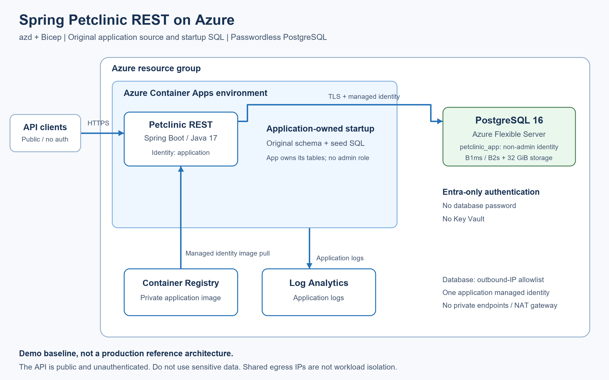

# Petclinic REST on Azure

A standalone azd template for the Spring Petclinic REST API (no web UI) on
Azure Container Apps with PostgreSQL 16. Managed identity authenticates to the
database and Container Registry; no database password or Key Vault is needed.
No azd extension is required.

**Demo only:** the API is public and unauthenticated. The app is a non-admin
database user, but can create and manage its own tables. Do not use sensitive data.

## Architecture



See the [editable diagram](docs/images/architecture.svg) and
[gallery submission assets](docs/gallery.md).

## Deploy

Install [azd](https://aka.ms/azd-install), Azure CLI, Docker, and PowerShell 7.
Start Docker and sign in to both CLIs with a user account in the target tenant:

```sh
az login
azd auth login
azd init -t weidongxu-microsoft/petclinic-rest-azd
azd up
```

Choose an environment, subscription, location, and database size.

| Size | Compute | Storage |
|---|---|---|
| `small` (default) | B1ms: 1 vCore, 2 GiB RAM | 32 GiB |
| `larger` | B2s: 2 vCores, 4 GiB RAM | 32 GiB |

Both are burstable demo configurations, not production tiers. Regional SKU
availability and subscription quota apply. For automation, set `DATABASE_SIZE`
with `azd env set` before provisioning; `--no-prompt` uses small unless saved.

Use a **fresh environment** when upgrading from a password-based version.
Reprovisioning does not migrate data or delete retired MySQL, Key Vault, jobs,
identities, secrets, or permissions.

The deploying identity needs resource creation and role-assignment permissions,
such as Contributor plus Role Based Access Control Administrator at subscription
scope. Preflight hooks select the signed-in Azure CLI user as PostgreSQL Entra
administrator before `azd up` resolves infrastructure parameters and before
standalone `azd provision`. Service-principal-only provisioning is not supported.
The lookup uses the existing ARM credential; no Microsoft Graph access is required.

After provisioning, the hook reconciles database firewall rules and uses your
short-lived Azure CLI token to map the app identity to `petclinic_app`. It grants
connection and schema creation permissions, not database administration.
A temporary rule allows only your detected public IPv4 address and is removed
on success or failure. Docker supplies the PostgreSQL client; no local `psql`
installation is needed.

Petclinic runs its original schema and seed SQL at startup. Restarting can restore
deleted sample records. The template changes only database connection and identity
settings; local profiles and other application defaults are preserved.

## Call the API

Use the app hostname from the HTTPS endpoint printed by azd:

| Endpoint | URL |
|---|---|
| Vets API | `https://<app-host>/petclinic/api/vets` |
| Swagger UI | `https://<app-host>/petclinic/swagger-ui.html` |
| Health | `https://<app-host>/petclinic/actuator/health` |

```sh
curl "https://<app-host>/petclinic/api/vets"
```

## Run locally

With JDK 17 installed, run from the project root:

```sh
sh ./mvnw spring-boot:run
```

On Windows PowerShell, use `.\mvnw.cmd spring-boot:run`.
The default `h2,spring-data-jpa` profiles use an in-memory database; no Azure
resources or firewall changes are needed. Data is lost when the process stops.
Open [Swagger UI](http://localhost:9966/petclinic/swagger-ui.html),
[the vets API](http://localhost:9966/petclinic/api/vets), or
[health](http://localhost:9966/petclinic/actuator/health). Stop with Ctrl+C.

## Security and troubleshooting

- Ingress is HTTPS-only; the bootstrap image has no public ingress.
- PostgreSQL password authentication is disabled. The JDBC authentication plugin
  obtains tokens using the app's user-assigned managed identity.
- Database connections verify the TLS certificate and hostname.
- The app owns its tables and has `USAGE, CREATE` on the `public` schema.
  It is not a read/write-only database role.
- Firewall rules named `aca-<IPv4-address-with-hyphens>` are template-owned.
  Reprovisioning removes obsolete rules and preserves unrelated rules, which can
  grant additional access. Reprovision if app outbound IPs change.
- No private endpoints or fixed-egress NAT gateway are configured. Shared egress
  IPs are not workload isolation; database authentication remains required.
- Do not commit `.azure/` or publish its contents.

If identity bootstrap fails, check Azure CLI tenant/sign-in and TCP 5432
connectivity. A proxy or VPN can make HTTPS IP discovery differ from database
egress; the hook does not broaden the firewall to work around that.
Rerun `azd provision` after correcting the cause.
If cleanup fails or the hook is forcibly interrupted, remove its
`petclinic-bootstrap-*` firewall rule from the selected server before retrying.

## Clean up

```sh
azd down
```

This deletes the database and application resources, including their data.
Database, container, registry, and logging usage incur Azure charges.

## Local checks and upstream source

With JDK 17 and the deployment prerequisites installed:

```sh
sh ./mvnw --batch-mode --no-transfer-progress verify
az bicep build --file infra/main.bicep
az bicep build --file infra/application.bicep
pwsh -File tests/Test-DatabaseFirewall.ps1
pwsh -File tests/Test-DatabaseIdentity.ps1
docker build --tag petclinic-rest:test .
pwsh -File tests/Test-ApplicationDatabase.ps1 -ApplicationImage petclinic-rest:test
```

The database test runs production bootstrap SQL against local Entra-function
stubs, then checks non-admin application startup and restart. It uses a local
password fixture, not Azure authentication; a live Azure deployment is needed
to verify managed identity end-to-end.

`src/` is unchanged from upstream commit
[`afc8fc1`](https://github.com/spring-petclinic/spring-petclinic-rest/tree/afc8fc1d3b8ec8de69414482b3bd70a1da78cb95).
`pom.xml` adds `azure-identity-extensions` for passwordless JDBC authentication.
See [UPSTREAM.md](UPSTREAM.md), [NOTICE](NOTICE), and [LICENSE.txt](LICENSE.txt).
